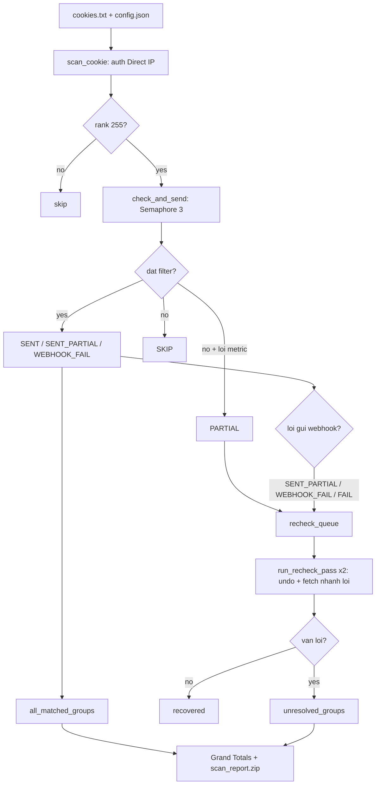

<div align="center">

# Owned Group Check

**Quét bất đồng bộ toàn bộ group Rank 255 từ cookie `.ROBLOSECURITY`, tách luồng auth Direct IP / public qua Tor, live Discord embed và chốt `scan_report.zip` ngay trong RAM.**

[](main.py)
[](requirements.txt)
[](#9-license)

</div>

## 1. Demo


Terminal preview (dashboard ANSI, `main.py`):

```text
ROBLOX GROUP OWNER SCANNER  v2.5.0
Status      : RUNNING

Target Acc  : LakoAcc01 (ID: 123456789)
Account Turn: 1/10
Group Queue : 14/42
Tor Network : Enabled (2 tunnels)
Filters     : R$100+ · pend 50+

-- METRICS ---------------------------------------------
  Owner Groups             42        Total Robux          15,400
  Filter Match              3        Pending Robux         4,200
  Skipped                  11        Partial Data              0

-- ACTIVITY --------------------------------------------
> 14:50:01  Account LakoAcc01 · ID 123456789 · 42 owner groups.
> 14:50:04  MATCH Group Alpha · id 1234567 · robux 12,000>=100 -> webhook ok

[Ctrl+C to stop]
```

Discord preview (thực tế từ `AccountStatus` + `send_grand_totals_webhook`):

```text
✅ [ACC 1/10] LakoAcc01
status  : FINISHED
checked : 42/42
robux   : 15,400
pending : 4,200
👑 Matched Groups (2)
• [1234567](https://www.roblox.com/groups/1234567) — 12,000 Robux · 4,000 Pending
• [8889999](https://www.roblox.com/groups/8889999) [⚠ MẤT QUYỀN] — 3,400 Robux

💎 Grand Totals — Tất cả account
accounts: 10
groups  : 420
matched : 15
robux   : 85,000
pending : 12,500
combined: 97,500
📎 scan_report.zip (matched_groups.txt + unresolved_groups.txt)
```

Report style (1 group / 1 dòng, không kẻ bảng):

```text
# matched_groups.txt — sort giảm dần robux+pending
https://www.roblox.com/groups/1234567 - LakoAcc01 - 12,000 Robux · 4,000 Pending
https://www.roblox.com/groups/8889999 - LakoAcc01 - 3,400 Robux · 25 Clothing

# unresolved_groups.txt
https://www.roblox.com/groups/4443332 - LakoAcc01
```

## 2. Features

- **Async engine (`asyncio` + `aiohttp`, `main.py` ~3.198 dòng / 88 hàm):** quét song song group bằng `Semaphore(3)`, gom 6 nhánh API (`currency`, `revenue`, `games`, `clothing`, `thumbnail`, `basic`) trong một lượt `gather` kèm timeout bảo vệ.
- **Split-session an toàn token:** request mang `.ROBLOSECURITY` / `x-csrf-token` luôn đi IP gốc; dữ liệu public (games, visits, clothing, group info) đi session trần, qua Tor khi bật.
- **Multi-instance Tor (`tor/tor_manager.py` + `tor/tor.exe`):** mỗi account / vòng re-check dùng credential `IsolateSOCKSAuth` riêng để ép circuit và exit IP mới.
- **Chống rate-limit:** `DomainPacer` giãn nhịp theo domain, 429 thì nhân đôi interval và hạ dần sau chuỗi thành công; 403 tự bắt `x-csrf-token` mới để retry.
- **Xác thực chủ 2 lớp:** lọc `rank == 255` rồi đối chiếu `owner.userId` với `current_user_id`; group kẹt rank nhưng mất quyền bị gắn `[⚠ MẤT QUYỀN]` (`fake_own`).
- **Re-check 2 vòng:** `PARTIAL` / `SENT_PARTIAL` / `FAIL` / `WEBHOOK_FAIL` được quét bù đúng nhánh lỗi (`_ok`), `_undo_result_stats` hoàn tác trước khi quét lại nên không đếm đôi; giữ bất biến `checked_success + checked_failed == owned_groups`.
- **Báo cáo gọn:** mỗi account 1 Discord message tự `PATCH` (`MAX_LISTED = 15`, sort `robux+pending` giảm dần); cuối phiên 1 embed Grand Totals YAML 6 dòng + điều kiện `recheck/partial/failed/fake_own`, kèm `scan_report.zip` nén trong RAM bằng `io.BytesIO` + `zipfile` (không ghi file rác).
- **Đã kiểm chứng:** `python -m py_compile main.py` OK; bộ `test_status_embed.py` / `test_smoke.py` / `test_ui_dash.py` đều `ALL TESTS PASSED`.

## 3. Disclaimer & Security Warning

> [!CAUTION]
> **Đọc kỹ trước khi dùng:**
>
> - **Rủi ro khóa tài khoản (TOS Roblox):** quét hàng loạt có thể bị giới hạn IP / khóa acc. Tool phục vụ nghiên cứu và kiểm kê tài sản cá nhân. **Tác giả không chịu trách nhiệm** cho mọi mất mát tài khoản, Robux hay dữ liệu.
> - **Tuyệt đối KHÔNG chia sẻ token/cookie/password:** `.ROBLOSECURITY` tương đương toàn quyền acc (vượt 2FA). Không gửi `cookies.txt` hay `config.json` (chứa webhook URL) cho bất kỳ ai.
> - **Chặn lộ secret lên git:** repo hiện **chưa có `.gitignore`**. Trước khi `git init` / push, hãy tạo `.gitignore` chứa ít nhất:
>
> ```gitignore
> config.json
> cookies.txt
> .env
> proxies.txt
> tor/data/
> __pycache__/
> ```

## 4. Quick Start

Yêu cầu: **Windows 10/11 + Python 3.9+** (đã kiểm tra chạy tốt trên Python 3.11.6).

```powershell
pip install -r requirements.txt
```

Phụ thuộc thực tế (`requirements.txt`, 3 gói): `aiohttp>=3.9.0`, `rich>=13.7.0`, `psutil>=5.9.0`.

Chuẩn bị `cookies.txt` (mỗi dòng 1 cookie, bắt đầu bằng `_|WARNING:-DO-NOT-SHARE-THIS.`, trùng lặp tự lọc) và `config.json`:

```json
{
    "webhook_url": "YOUR_WEBHOOK_URL_HERE",
    "discord_id": "YOUR_DISCORD_ID_HERE",
    "status_embed": true,
    "terminal_ui": "dashboard",
    "tor": { "enabled": true, "amount": 2, "port": 10080 }
}
```

| Trường | Kiểu | Mô tả |
| :--- | :--- | :--- |
| `webhook_url` | `string` | Discord webhook nhận embed và `scan_report.zip`. |
| `discord_id` | `string` | ID để ping `<@id>` khi có group đạt filter. |
| `status_embed` | `bool` | `true` = 1 message live/account; `false` = webhook lẻ từng group. |
| `terminal_ui` | `string` | `"dashboard"` (ANSI live) hoặc `"classic"` (log Rich). |
| `tor.enabled/amount/port` | `bool/int/int` | Bật Tor public, số tunnel, cổng SOCKS5 bắt đầu. |

Chạy:

```powershell
python main.py
```

Sau đó nhập ngưỡng filter theo wizard (Robux, Pending, Games, Visits, Clothing).

## 5. Cấu trúc thư mục & Workflow

```text
Owned-group-check/
├── main.py              # Scanner v2.5.0: async engine, DomainPacer, UI, webhook, ZIP
├── config.json          # Webhook, Discord ID, UI, Tor (KHÔNG commit file thật)
├── cookies.txt          # Input cookie (KHÔNG commit file thật)
├── requirements.txt     # aiohttp, rich, psutil
└── tor/
    ├── __init__.py
    ├── tor_manager.py   # Vòng đời N tiến trình tor.exe, IsolateSOCKSAuth
    └── tor.exe          # Binary Tor (Windows)
```

Luồng chạy (`GroupScanner.start` trong `main.py`):

```text
Input (cookies.txt + config.json + filter wizard)
  → scan_cookie từng acc (auth Direct IP, public qua Tor nếu bật)
  → check_and_send từng group (Semaphore 3, commit stats atomic 1 lần)
  → run_recheck_pass 2 vòng (undo stats cũ, chỉ fetch nhánh lỗi)
  → send_grand_totals_webhook (YAML gọn + scan_report.zip trong RAM)
Output (dashboard terminal + Discord embed/account + Grand Totals + ZIP)
```



## 6. Troubleshooting / FAQ

1. **`ModuleNotFoundError: No module named 'aiohttp'`**
   Chưa cài deps hoặc sai interpreter. Chạy `python -m pip install -r requirements.txt` đúng venv rồi chạy lại `python main.py`.

2. **Sai format cookie / `401 Unauthorized`, không quét được acc**
   Cookie phải nguyên dòng, bắt đầu bằng `_|WARNING:-DO-NOT-SHARE-THIS.`. Cookie `401/403` được đếm vào `invalid_cookies`, không đưa vào scan. Lấy cookie mới và giữ mỗi cookie 1 dòng trong `cookies.txt`.

3. **Token/CSRF hết hạn (`403`, `x-csrf-token`) hoặc proxy/Tor lỗi**
   Code đã tự bắt `x-csrf-token` mới từ header `403` để retry. Nếu Tor chiếm cổng (`port` trong `tor` bị kẹt) hoặc thiếu `tor/tor.exe`, đặt `"tor": {"enabled": false}` để chạy Direct IP hoàn toàn.

4. **Rate-limit `429` / group kẹt `PARTIAL`, quét chậm dần**
   Hành vi dự kiến khi Roblox giới hạn IP. `DomainPacer` tự giãn nhịp; cuối phiên `run_recheck_pass` đổi exit IP và quét bù đúng nhánh lỗi. Tăng `tor.amount` (ví dụ 2 → 5) để phân tải, và đợi ZIP cuối cùng thay vì dừng giữa chừng.

## 7. Connect & Support

- Discord: <https://discord.gg/rxw8Hwk3qA>
- TikTok: [@lakofusion](https://www.tiktok.com/@lakofusion)
- YouTube: [@lakofusion2010](https://www.youtube.com/@lakofusion2010)

## 8. License

MIT License.
